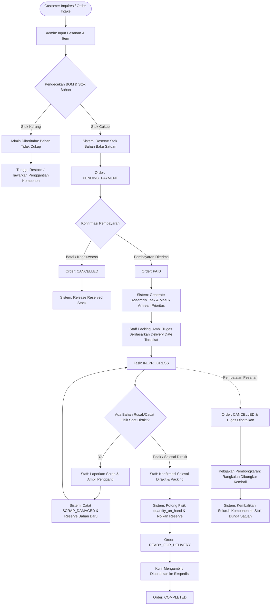
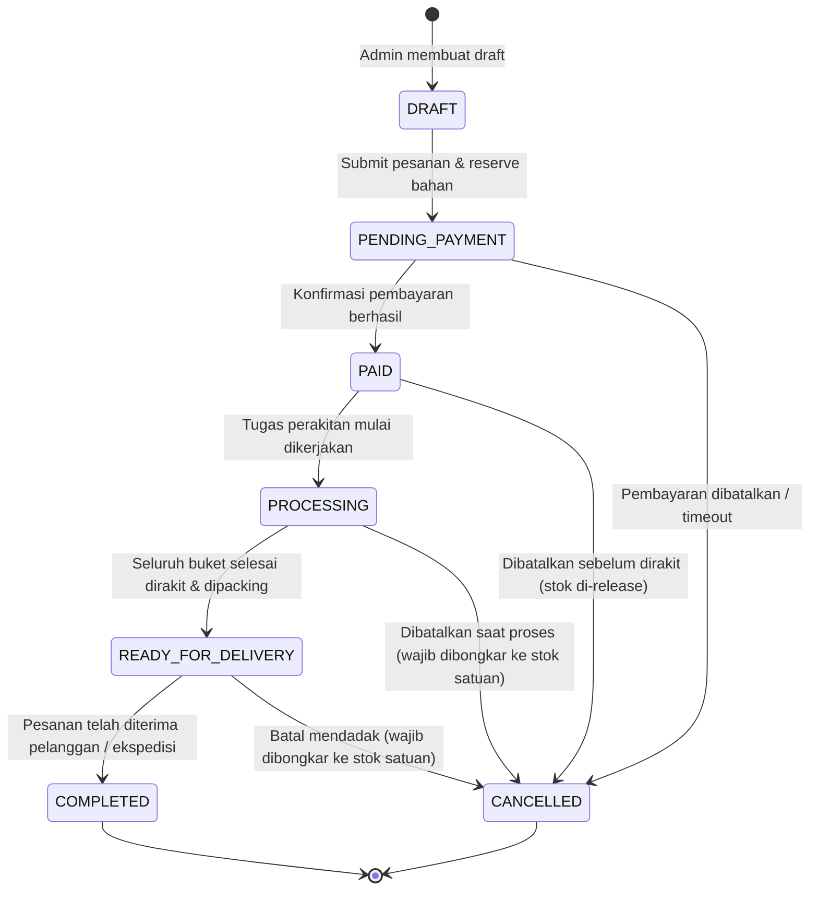
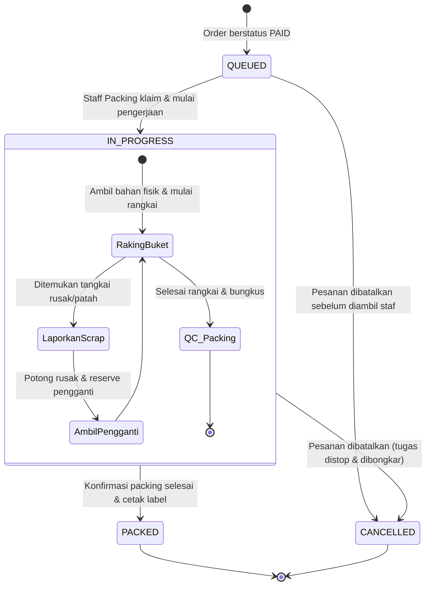
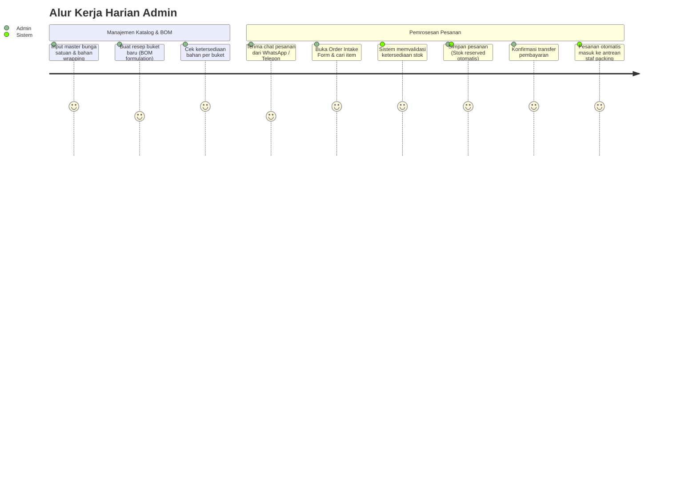
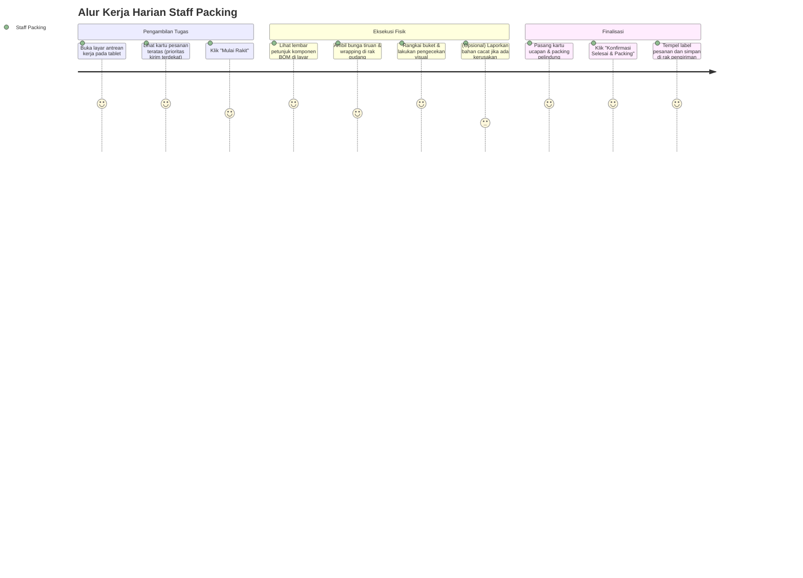
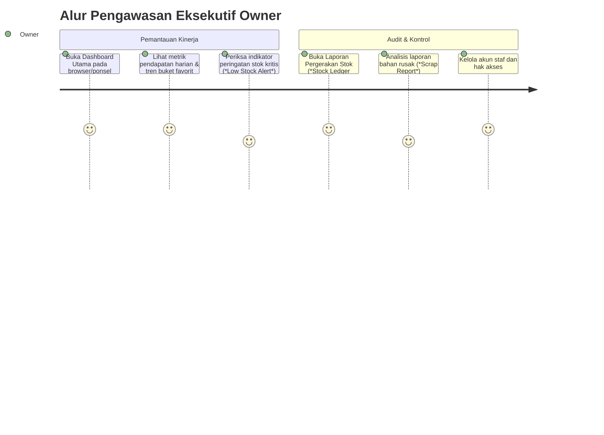

# Application Flow Document (AFD)
## LaRose Floral Studio — End-to-End Business Workflows & Finite State Machines

---

### 1. Makro Flowchart Proses Bisnis (End-to-End Lifecycle)

Flowchart berikut memetakan perjalanan pesanan sejak diterima oleh Admin hingga siap dikirim, mencakup integrasi alur stok, perakitan, dan penanganan kasus khusus.



---

### 2. Finite State Machine (FSM)

Sistem mengelola dua mesin status independen namun terhubung erat: **Order Lifecycle FSM** dan **Assembly Task FSM**.

#### 2.1 Order State Machine
Tabel status pesanan pelanggan dan kondisi transisinya:



| Transisi | Trigger Event | Validasi & Efek Samping Database |
| :--- | :--- | :--- |
| `DRAFT` $\rightarrow$ `PENDING_PAYMENT` | `SUBMIT_ORDER` | Validasi BOM, cek ketersediaan bahan, lakukan `SELECT ... FOR UPDATE`, update `quantity_reserved += needed`, buat `stock_movements (ORDER_RESERVED)`. |
| `PENDING_PAYMENT` $\rightarrow$ `PAID` | `CONFIRM_PAYMENT` | Rekam waktu pembayaran, ubah status order, picu pembuatan `assembly_tasks` dengan prioritas jadwal kirim. |
| `PAID` $\rightarrow$ `PROCESSING` | `START_ASSEMBLY` | Di-trigger saat Staff Packing menekan tombol *Mulai Rakit* pada antrean tugas. |
| `PROCESSING` $\rightarrow$ `READY_FOR_DELIVERY` | `FINISH_ASSEMBLY` | Di-trigger saat Staff Packing menyelesaikan packing: potong `quantity_on_hand -= needed`, `quantity_reserved -= needed`, rekam `stock_movements (ASSEMBLY_DEDUCTED)`. |
| `READY_FOR_DELIVERY` $\rightarrow$ `COMPLETED` | `DISPATCH_ORDER` | Di-trigger saat barang di-pickup atau resi pengiriman diserahkan. |
| Status Apapun $\rightarrow$ `CANCELLED` | `CANCEL_ORDER` | **Kebijakan Pembongkaran Penuh**: Jika masih reserved, lepaskan reserve. Jika sudah dipotong fisik (dalam pengerjaan/selesai), seluruh komponen dibongkar dan dikembalikan ke `quantity_on_hand` stok satuan via `stock_movements (ORDER_RELEASED / DISASSEMBLY_RETURN)`. |

---

#### 2.2 Assembly Task State Machine (Tugas Perakitan Staf)



---

### 3. Penanganan Kasus Khusus (Exception & Edge Case Workflows)

#### 3.1 Kasus Pembatalan Pesanan & Kebijakan Pembongkaran (Order Cancellation & Full Disassembly)
* **Aturan Bisnis Mutlak**: Sesuai kebijakan operasional toko bunga artifisial LaRose, setiap pesanan yang dibatalkan pada tahap apa pun **wajib dibongkar kembali (*full disassembly*)**.
* **Alur Eksekusi Sistem**:
  1. Admin memicu aksi `Cancel Order` dengan mencantumkan alasan pembatalan.
  2. Sistem memeriksa posisi status pesanan:
     * **Jika status `PENDING_PAYMENT` atau `PAID` (belum dirakit)**:
       * Sistem secara atomik melepaskan kuantitas teralokasi: `quantity_reserved -= needed`.
       * Mencatat mutasi `stock_movements` tipe `ORDER_RELEASED`.
     * **Jika status `PROCESSING` atau `READY_FOR_DELIVERY` (sudah dirakit/dipacking)**:
       * Sistem membatalkan `assembly_tasks`.
       * Menghasilkan tugas fisik untuk Staff Packing: *"Tugas Pembongkaran Buket #ORD-xxx"*.
       * Komponen buket dikembalikan ke stok fisik: `quantity_on_hand += needed` untuk setiap bahan penyusunnya, dan direkam pada `stock_movements` sebagai `DISASSEMBLY_RETURN`.

#### 3.2 Kasus Bahan Cacat / Rusak Fisik saat Perakitan (Assembly Scrap / Defect Quick Report)
* **Masalah**: Saat proses penusukan atau perangkaian buket, terkadang tangkai bunga tiruan bengkok patah atau kain kelopak sobek.
* **Solusi Sistem**:
  1. Pada antrean layar Staff Packing, terdapat tombol aksi cepat: `+ Laporkan Bahan Rusak`.
  2. Staff memilih bahan yang rusak (misal: 1 pcs *Rose Tangkai Velvet Merah*) dan alasan (misal: *Tangkai patah saat assembling*).
  3. Sistem memproses transaksi atomik dalam satu langkah:
     * Mengurangi stok fisik bahan rusak dari gudang: `quantity_on_hand -= 1`.
     * Mencatat `stock_movements` dengan tipe `SCRAP_DAMAGED`.
     * Mengalokasikan 1 pcs bahan pengganti dari stok tersedia: `quantity_reserved += 1`.
     * Memberikan notifikasi visual hijau kepada staf: *"Bahan pengganti dialokasikan. Silakan ambil 1 unit pengganti di rak."*
  4. **Jika Bahan Pengganti Habis di Gudang**: Sistem menghentikan pengerjaan, mengubah status tugas menjadi `BLOCKED_OUT_OF_STOCK`, dan secara otomatis memberikan notifikasi darurat kepada Admin.

#### 3.3 Penjadwalan & Algoritma Prioritas Antrean Staff Packing
* **Logika Pengurutan (*Sorting Algorithm*)**:
  Antrean kerja perakitan Staff Packing diurutkan secara deterministik menggunakan kriteria berjenjang:
  $$\text{Priority Order} = \text{delivery\_date ASC} \longrightarrow \text{created\_at ASC}$$
* **Visualisasi Indikator Waktu**:
  * 🔴 **Kritis (Merah)**: `delivery_date` hari ini atau besok pagi.
  * 🟡 **Peringatan (Kuning)**: `delivery_date` dalam 2-3 hari ke depan.
  * 🟢 **Normal (Hijau)**: `delivery_date` lebih dari 3 hari ke depan.

---

### 4. Alur Perjalanan Pengguna (User Journeys)

#### 4.1 Perjalanan Admin (Order Intake & Catalog Management)


#### 4.2 Perjalanan Staff Packing (Assembly & Fulfillment)


#### 4.3 Perjalanan Owner (Executive Monitoring & Governance)


---

### 5. Wireflow Antarmuka Tekstual (UI Conceptual Wireflows)

#### 5.1 Workspace Admin: Form Pembuatan Pesanan (*Order Intake*)
```
+------------------------------------------------------------------------------------+
| LaRose Studio | Admin Workspace > Buat Pesanan Baru                                |
+------------------------------------------------------------------------------------+
| [Informasi Pelanggan]                                                              |
| Nama Lengkap : [ Siti Nurhaliza                 ]  No. WhatsApp: [ 081234567890  ] |
| Alamat Kirim : [ Jl. Melati No. 12, Jakarta Selatan                             ] |
| Tgl Kirim    : [ 2026-11-12 ] (2 Hari Lagi - Status: NORMAL)                      |
|                                                                                    |
| [Rincian Item Pesanan]                                                             |
| + Tambah Produk [ Cari SKU / Nama Produk...                     ] [ + Tambah ]     |
| ---------------------------------------------------------------------------------- |
| Item                    Tipe       Qty   Harga Satuan     Subtotal    Stok BOM     |
| ---------------------------------------------------------------------------------- |
| Buket Rose Velvet M     BOUQUET     2    Rp 175.000       Rp 350.000  [ CUKUP  v ] |
|   -> 10x Mawar Merah Palsu (Tersedia: 45)                                          |
|   -> 2x Kertas Cellophane Putih (Tersedia: 20)                                     |
|   -> 1x Pita Satin Merah (Tersedia: 15)                                            |
| Lily Artifisial Putih   SINGLE      3    Rp  25.000       Rp  75.000  [ CUKUP  v ] |
| ---------------------------------------------------------------------------------- |
|                                             Total Pembayaran: Rp 425.000           |
| Catatan Khusus : [ Tolong kartu ucapan: Selamat Ulang Tahun ke-25 Sarah!         ] |
|                                                                                    |
| [ Batal ]                                           [ Simpan & Kunci Stok (FSM) ]  |
+------------------------------------------------------------------------------------+
```

#### 5.2 Layar Kerja Staff Packing: Antrean Perakitan (*Assembly Queue - Tablet View*)
```
+------------------------------------------------------------------------------------+
| LaRose Ops | Antrean Perakitan & Packing                           [ Refresh ] [🔔 2]
+------------------------------------------------------------------------------------+
| FILTER: [ Semua (4) ] [ Prioritas Hari Ini (1) ] [ Besok (2) ]                     |
|                                                                                    |
| [KARTU TUGAS #1] ------------------------------------------------- [ 🔴 KIRIM BESOK ]
| No. Pesanan : ORD-202611-0012                  Waktu Kirim : 11 Nov 2026, 10:00 WIB
| Penerima    : Siti Nurhaliza (Jakarta Selatan)
| Produk      : 1x Buket Rose Velvet M (Custom Pita Merah)
| Bahan BOM yang Harus Diambil dari Rak:
|   [ ] Rak B2 - 5x Tangkai Mawar Velvet Merah
|   [ ] Rak W1 - 1x Lembar Cellophane Matte Putih
|   [ ] Rak P3 - 1x Pita Satin Merah (1 Meter)
| Catatan     : Sisipkan kartu ucapan #CARD-08
| ---------------------------------------------------------------------------------- |
| [ ⚠️ Laporkan Bahan Rusak (Scrap) ]                [ ▶️ Mulai Rakit ] [ ✅ Selesai ] |
+------------------------------------------------------------------------------------+
| [KARTU TUGAS #2] ------------------------------------------------- [ 🟡 KIRIM 2 HARI]
| No. Pesanan : ORD-202611-0014                  Waktu Kirim : 12 Nov 2026, 14:00 WIB
| ...                                                                                |
+------------------------------------------------------------------------------------+
```

#### 5.3 Dashboard Eksekutif Owner (*Executive Analytics Overview*)
```
+------------------------------------------------------------------------------------+
| LaRose Studio | Executive Overview                                   Owner: Alex v |
+------------------------------------------------------------------------------------+
| [ METRIK HARI INI ]                                                                |
| Omzet Terkonfirmasi : Rp 3.850.000   | Pesanan Aktif        : 14 Pesanan           |
| Nilai Valuasi Stok  : Rp 48.200.000  | Total Bahan Rusak    : 3 pcs (Scrap Rate:0.4%)
| ---------------------------------------------------------------------------------- |
| [ PERINGATAN STOK KRITIS (Low Stock Alert) ]                                       |
| - Mawar Velvet Merah Artifisial (SKU: ART-ROSE-01) -> Sisa: 8 Tangkai (Batas: 20)  |
| - Cellophane Hitam Matte (SKU: MAT-WRAP-03)        -> Sisa: 3 Lembar  (Batas: 15)  |
|                                                                                    |
| [ TREN BUKET TERLARIS ]                     | [ PRODUKTIVITAS TIM PACKING ]        |
| 1. Buket Valentine Velvet M (38 terjual)    | Budi Santoso   : 8 Buket selesai     |
| 2. Buket Meja Eucalyptus L  (22 terjual)    | Rina Melati    : 6 Buket selesai     |
| ---------------------------------------------------------------------------------- |
| [ Unduh Laporan Keuangan CSV ]                   [ Buka Log Audit Mutasi Stok ]    |
+------------------------------------------------------------------------------------+
```
