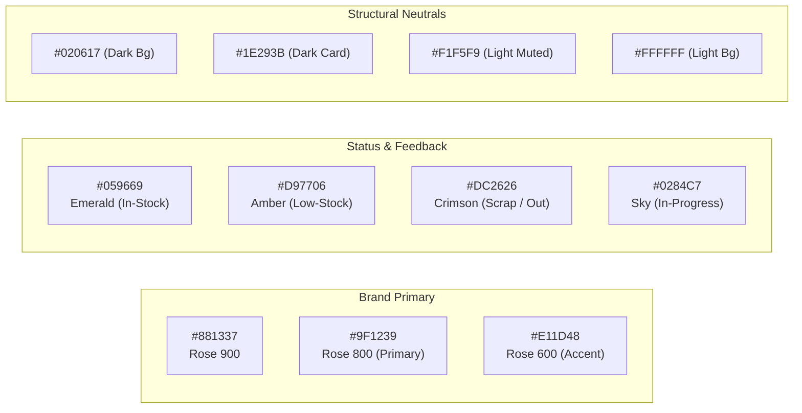

# Design Brief Document (DBD)
## LaRose Floral Studio — Visual Design Guidelines, Design Tokens & Ergonomics

---

### 1. Prinsip Desain & Karakter Brand (Design Philosophy)

Antarmuka LaRose Floral Studio memadukan dua karakter utama:
1. **Artisanal Elegance**: Sentuhan estetika floral premium, bersih, anggun, dan berkelas yang merefleksikan keindahan produk bunga artifisial studio.
2. **Modern Operational Efficiency**: Tata letak terstruktur dengan densitas informasi optimal, kontras tinggi, dan interaksi responsif yang mendukung kecepatan kerja operasional backoffice harian tanpa distraksi visual.

#### Tiga Pilar Desain Utama:
* **Clarity Over Clutter**: Informasi status stok, rincian komponen BOM, dan jadwal pengiriman harus dapat dipindai secara visual (*glanceable*) dalam hitungan detik.
* **Ergonomic In Action**: Elemen antarmuka dirancang menyesuaikan lingkungan fisik pengguna — mulai dari meja kantor Admin (interaksi keyboard/mouse intensif) hingga meja perakitan Staff Packing (layar sentuh tablet dengan target sentuh besar).
* **Consistent Semantic Feedback**: Warna status (Aman, Menipis, Habis, Kritis) memiliki arti yang konsisten di seluruh modul dan tema tampilan.

---

### 2. Sistem Tipografi (Typography System)

Kombinasi tipografi modern dirancang untuk membedakan antara identitas brand yang anggun dan kejelasan data operasional:

| Peran Tipografi | Font Family | Bobot (*Weight*) | Karakter & Penggunaan |
| :--- | :--- | :--- | :--- |
| **Brand Accent & Headings** | `Playfair Display`, serif | SemiBold (600), Bold (700) | Judul brand, kartu laporan eksekutif, nama buket koleksi utama. |
| **Primary UI & Body** | `Plus Jakarta Sans`, sans-serif | Regular (400), Medium (500) | Teks antarmuka, label form, deskripsi produk, instruksi perakitan. |
| **Tabular & Numeric Data** | `Plus Jakarta Sans` / `JetBrains Mono` | Medium (500), Bold (700) | Angka harga, kuantitas stok, nomor SKU, nomor pesanan (`ORD-xxx`), nomor rak gudang. Fitur `font-variant-numeric: tabular-nums` aktif untuk perataan kolom angka. |

#### Skala Tipe (*Type Scale*):
* `text-xs`: 12px / Line-height 16px (Metadata label, timestamp, badge status)
* `text-sm`: 14px / Line-height 20px (Tabel data, form input, body text sekunder)
* `text-base`: 16px / Line-height 24px (Body text primer, default UI labels)
* `text-lg`: 18px / Line-height 28px (Subheading, modal header, card title)
* `text-xl`: 20px / Line-height 28px (Section header, metric value cards)
* `text-2xl` ~ `text-3xl`: 24px - 30px (Page header, executive revenue numbers)

---

### 3. Palet Warna & Token Semantik (Color Palette & Semantic Tokens)

Sistem warna dibangun di atas fondasi warna **Deep Velvet Rose** sebagai identitas brand, dipadukan dengan **Slate Neutral** untuk struktur, serta warna fungsional untuk status ketersediaan inventaris dan pesanan.



#### Spesifikasi HSL & Hexadecimal:
* **Primary (Velvet Rose)**:
  * `brand-primary`: `#9F1239` (HSL: `345°, 78%, 35%`) — Tombol aksi utama, brand header aktif, highlight status.
  * `brand-hover`: `#881337` (HSL: `345°, 75%, 30%`) — Hover state tombol.
  * `brand-subtle`: `#FFE4E6` (Light) / `#4C0519` (Dark) — Background badge buket dan aksen lembut.
* **Success / In-Stock (Emerald)**:
  * `#059669` (Dark: `#10B981`) — Stok bahan lengkap, buket selesai dirakit, pembayaran lunas.
* **Warning / Low-Stock (Amber)**:
  * `#D97706` (Dark: `#F59E0B`) — Stok mendekati *reorder point*, pesanan mendekati batas waktu kirim (H-1).
* **Destructive / Error / Scrap (Crimson)**:
  * `#DC2626` (Dark: `#EF4444`) — Bahan rusak/scrap, pesanan dibatalkan, stok bahan habis (0).
* **Informational / Processing (Sky)**:
  * `#0284C7` (Dark: `#38BDF8`) — Tugas sedang dirakit (`IN_PROGRESS`), proses delivery.

---

### 4. Strategi Dual-Theme: Light Mode & Dark Mode (shadcn/ui Compatible)

Sistem mendukung perpindahan tema (*theme toggle*) secara menyeluruh dengan token CSS Variables berbasis arsitektur **shadcn/ui & Tailwind CSS**.

```css
/* Light Theme (Default: Bersih, Kontras Tinggi, Elegan) */
:root {
  --background: 0 0% 100%;             /* #ffffff */
  --foreground: 222.2 84% 4.9%;        /* #020817 */
  --card: 0 0% 100%;                   /* #ffffff */
  --card-foreground: 222.2 84% 4.9%;
  --popover: 0 0% 100%;
  --popover-foreground: 222.2 84% 4.9%;
  --primary: 345 78% 35%;              /* #9F1239 - Velvet Rose */
  --primary-foreground: 355 100% 97%;  /* #fff1f2 */
  --secondary: 210 40% 96.1%;          /* #f1f5f9 */
  --secondary-foreground: 222.2 47.4% 11.2%;
  --muted: 210 40% 96.1%;
  --muted-foreground: 215.4 16.3% 46.9%;
  --accent: 345 78% 95%;               /* Soft Rose Accent */
  --accent-foreground: 345 78% 35%;
  --destructive: 0 84.2% 60.2%;        /* #ef4444 */
  --destructive-foreground: 210 40% 98%;
  --border: 214.3 31.8% 91.4%;         /* #e2e8f0 */
  --input: 214.3 31.8% 91.4%;
  --ring: 345 78% 35%;
  --radius: 0.5rem;                    /* 8px rounded corners */
}

/* Dark Theme (Ramah Penglihatan di Meja Kerja Perakitan / Tablet) */
.dark {
  --background: 222.2 84% 4.9%;        /* #020817 - Deep Slate */
  --foreground: 210 40% 98%;           /* #f8fafc */
  --card: 222.2 84% 7%;                /* #0b1120 */
  --card-foreground: 210 40% 98%;
  --popover: 222.2 84% 7%;
  --popover-foreground: 210 40% 98%;
  --primary: 345 78% 45%;              /* Sedikit lebih terang di dark mode */
  --primary-foreground: 355 100% 97%;
  --secondary: 217.2 32.6% 17.5%;      /* #1e293b */
  --secondary-foreground: 210 40% 98%;
  --muted: 217.2 32.6% 17.5%;
  --muted-foreground: 215 20.2% 65.1%;
  --accent: 345 50% 20%;
  --accent-foreground: 345 78% 85%;
  --destructive: 0 62.8% 30.6%;
  --destructive-foreground: 210 40% 98%;
  --border: 217.2 32.6% 17.5%;         /* #1e293b */
  --input: 217.2 32.6% 17.5%;
  --ring: 345 78% 45%;
}
```

---

### 5. Ergonomi & Human Factors Lingkungan Operasional

Perancangan UI disesuaikan secara presisi terhadap konteks fisik pengguna:

#### 5.1 Lingkungan 1: Meja Kantor Admin (Desktop / Laptop)
* **Karakteristik**: Penggunaan keyboard dan mouse terus-menerus, entri order cepat, komunikasi paralel dengan pelanggan via WhatsApp Web.
* **Fitur Ergonomi**:
  * **Compact Data Density**: Tabel katalog produk dan daftar pesanan memuat banyak baris per layar tanpa harus sering melakukan scroll vertikal.
  * **Keyboard Shortcuts**: `Ctrl/Cmd + K` untuk pencarian global produk/pesanan; `Enter` untuk konfirmasi item; `Esc` untuk menutup dialog.
  * **Inline BOM Validator**: Saat memilih buket, indikator ketersediaan seluruh bahan satuan langsung tampil di samping kuantitas tanpa berpindah halaman.

#### 5.2 Lingkungan 2: Meja Perakitan Staff Packing (Tablet 10-12" / Layar Sentuh)
* **Karakteristik**: Tangan operator mungkin memegang tangkai bunga, lem tembak, atau gunting; jarak pandang sekitar 50–70 cm.
* **Fitur Ergonomi**:
  * **Large Touch Targets**: Seluruh tombol interaksi (Mulai Rakit, Laporkan Scrap, Selesai) memiliki dimensi minimal $48 \times 48\text{ px}$ untuk mencegah salah tekan.
  * **High Contrast Typography**: Informasi nomor rak penyimpanan (misal: **`RAK B2`**) dan kuantitas bahan yang harus diambil ditampilkan dalam ukuran besar dan tebal (*Bold Font, High Visibility*).
  * **Modal Scrap Cepat**: Tombol *Laporkan Bahan Rusak* langsung membuka opsi sentuh satu-ketukan (*one-tap counters*), mengurangi kebutuhan mengetik teks panjang.

#### 5.3 Lingkungan 3: Dashboard Owner (Mobile Browser & Desktop)
* **Karakteristik**: Memantau kesehatan finansial studio saat bepergian atau di luar jam operasional toko.
* **Fitur Ergonomi**:
  * Kartu ringkasan metrik berbasis *Hero KPI* (Omzet, Total Order, Tingkat Scrap, Valuasi Stok).
  * Desain sepenuhnya adaptif (*fluid responsive*) dari layar smartphone 390px hingga layar desktop 4K.

---

### 6. Desain Komponen Inti (Component Specifications)

Berdasarkan pustaka komponen **shadcn/ui (Radix UI + Tailwind)**:

#### 6.1 Status Badges (Pill Indicators)
* Pesanan `PENDING_PAYMENT`: Background Amber lembut, teks Amber tebal, ikon jam.
* Pesanan `PAID`: Background Blue lembut, teks Blue tebal, ikon kartu kredit.
* Pesanan `PROCESSING`: Background Purple lembut, teks Purple tebal, ikon roda gigi/perakitan.
* Pesanan `READY_FOR_DELIVERY`: Background Emerald lembut, teks Emerald tebal, ikon paket siap.
* Pesanan `COMPLETED`: Background Slate netral, teks Slate tebal, ikon centang.
* Pesanan `CANCELLED`: Background Red lembut, teks Red tebal, garis coret visual.

#### 6.2 Kartu Antrean Perakitan (Assembly Task Card)
* **Header Kartu**: Menampilkan nomor pesanan berhuruf monospace tebal dan badge tenggat waktu (`🔴 Kirim Hari Ini`, `🟡 Besok`, `🟢 Lusa`).
* **Komponen Bahan (Checklist Interaktif)**: Daftar checkbox yang dapat disentuh staf saat bahan fisik telah diambil dari rak penyimpanan.
* **Footer Kartu**: Tombol aksi primer (*Mulai Rakit* $\rightarrow$ *Selesai*) dan tombol sekunder beraksen peringatan (*Laporkan Kerusakan Bahan*).

#### 6.3 Dialog Konfirmasi Pembatalan (Cancellation & Disassembly Dialog)
* Banner peringatan warna oranye/merah: *"Pesanan ini telah dirakit. Melanjutkan pembatalan akan menghasilkan instruksi pembongkaran buket dan mengembalikan X tangkai mawar ke stok satuan."*
* Input wajib: Alasan pembatalan (dropdown + catatan).

---

### 7. Standar Aksesibilitas (WCAG 2.1 AA Compliance)

1. **Rasio Kontras Warna**:
   * Seluruh teks primer dan label memenuhi rasio kontras minimal $4.5:1$ terhadap background pada Light maupun Dark mode.
   * Teks berukuran besar ($\ge 18\text{pt}$ atau $\ge 14\text{pt}$ bold) memenuhi rasio kontras minimal $3:1$.
2. **Fokus Visual & Navigasi Keyboard**:
   * Setiap elemen interaktif (input, button, dropdown, checkbox) memiliki cincin fokus yang jelas (`ring-2 ring-rose-600 ring-offset-2`).
3. **Screen Readers & ARIA Labels**:
   * Tombol yang hanya memuat ikon (misal tombol refresh, icon hapus item) wajib dilengkapi atribut `aria-label` eksplisit (contoh: `aria-label="Laporkan bahan mawar rusak"`).
