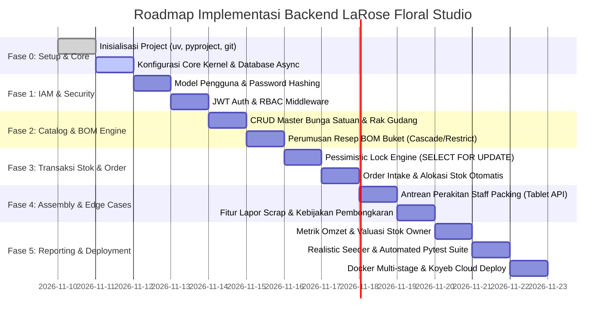

# Implementation Plan Document (IPD)
## LaRose Floral Studio — Phased Roadmap, CLI Workflows & Definition of Done

---

### 1. Prinsip Eksekusi Rekayasa (Engineering Execution Principles)

Implementasi backend LaRose Floral Studio mengadopsi pendekatan **Vertical Slice First** yang dipadukan dengan standar *tooling* modern:

1. **Vertical Slice First**:
   * Alih-alih membangun seluruh lapisan data secara horizontal terlebih dahulu, kita membangun fondasi inti (*Core & IAM*) lalu langsung menyelesaikan **1 irisan vertikal penuh alur bisnis kritis** (Katalog $\rightarrow$ Komponen BOM $\rightarrow$ Transaksi Stok Atomik $\rightarrow$ Order Intake). Pendekatan ini memastikan logika konkurensi stok teruji secara nyata sejak dini.
2. **Modern Python Tooling (`uv`)**:
   * Menggunakan **`uv`** (Astral) sebagai *package manager* dan *virtual environment runner* tercepat berstandar PEP 621 (`pyproject.toml`), menghasilkan *lockfile* deterministik (`uv.lock`) yang dapat direproduksi secara konsisten di Koyeb PaaS.
3. **Realistic Studio Seeder**:
   * Menyertakan script seeder otomatis yang menginjeksikan 3 akun peran (Owner, Admin, Staff Packing), 10 bahan bunga satuan & perlengkapan wrapping, serta 3 resep buket populer lengkap dengan stok awal. Sistem langsung siap didemokan melalui antarmuka Swagger UI.
4. **Automated Quality Gate (Ruff + Pytest + CI)**:
   * **Ruff** untuk *linting* dan pemformatan kode super cepat.
   * **Pytest + pytest-asyncio** untuk pengujian unit dan pengujian transaksi konkurensi.
   * **GitHub Actions** untuk menjalankan pengujian otomatis pada setiap *push* sebelum dideploy ke Koyeb.

---

### 2. Diagram Rencana Kerja (Work Breakdown Structure & Timeline)



---

### 3. Rincian Langkah Kerja Berjenjang (Detailed Phase Breakdown)

#### Fase 0: Project Setup, Tooling & Core Shared Kernel
* **Tujuan**: Membangun fondasi proyek yang bersih, konfigurasi environment, dan koneksi asinkron ke PostgreSQL Supabase.
* **Langkah-langkah**:
  1. Inisialisasi proyek menggunakan `uv init --app` dan buat `pyproject.toml` dengan dependensi: `fastapi`, `uvicorn[standard]`, `sqlalchemy[asyncio]`, `asyncpg`, `alembic`, `pydantic-settings`, `passlib[bcrypt]`, `pyjwt`, `ruff`, `pytest`, `pytest-asyncio`, `httpx`.
  2. Implementasikan `src/core/config.py` (Pydantic BaseSettings membaca `.env`).
  3. Implementasikan `src/core/database.py` (Async engine SQLAlchemy dengan SSL & async sessionmaker).
  4. Implementasikan `src/core/security.py` (Bcrypt hashing & JWT encode/decode).
  5. Inisialisasi Alembic dengan template asinkron (`alembic init -t async migrations`).

#### Fase 1: Modul IAM (Identity & Access Management)
* **Tujuan**: Otentikasi aman berbasis JWT dan otorisasi berjenjang (Owner, Admin, Staff Packing).
* **Langkah-langkah**:
  1. Buat model SQLAlchemy `User` di `src/modules/iam/models.py`.
  2. Susun DTO Pydantic (`UserCreate`, `UserResponse`, `TokenResponse`) di `src/modules/iam/schemas.py`.
  3. Implementasikan `UserRepository` dan `IAMService` (validasi kata sandi, pembuatan token).
  4. Susun FastAPI router di `src/modules/iam/router.py` dengan dependensi `get_current_user` dan `require_role(allowed_roles)`.

#### Fase 2: Modul Catalog & Dynamic Bill of Materials (BOM)
* **Tujuan**: Pengelolaan master bunga satuan, bahan pembungkus, lokasi rak, dan resep perakitan buket.
* **Langkah-langkah**:
  1. Buat model `Product` dan `BOMComponent` di `src/modules/catalog/models.py`.
  2. Buat DTO Pydantic (`ProductCreate`, `ProductResponse`, `BOMComponentItem`) dengan `CamelModel`.
  3. Bangun logika validasi: mencegah *self-referencing* (buket tidak boleh tersusun dari dirinya sendiri) dan memastikan komponen material bertipe `SINGLE_ITEM`.
  4. Sediakan endpoint katalog dengan filter tipe produk, pencarian nama/SKU, dan pagination.

#### Fase 3: Modul Inventory & Order Intake (Atomic Concurrency Slice)
* **Tujuan**: Transaksi stok atomik bebas *race condition* saat pembuatan pesanan.
* **Langkah-langkah**:
  1. Buat model `Inventory`, `StockMovement`, `Order`, dan `OrderItem`.
  2. Implementasikan **Pessimistic Locking Service**:
     * Mengekspansi seluruh buket menjadi kebutuhan bahan satuan.
     * Mengurutkan ID bahan secara deterministik (`ORDER BY product_id ASC`).
     * Menjalankan kueri `SELECT ... FOR UPDATE` dalam transaksi ACID.
     * Mengupdate `quantity_reserved` dan mencatat `stock_movements (ORDER_RESERVED)`.
  3. Buat endpoint `POST /api/v1/orders` yang dapat diakses oleh Admin untuk memproses order intake.
  4. Buat endpoint `PATCH /api/v1/orders/{id}/payment` untuk konfirmasi pembayaran (`PAID`) yang otomatis memicu pembuatan tugas perakitan.

#### Fase 4: Modul Assembly Operations, Scrap Reporting & Full Disassembly
* **Tujuan**: Mengelola alur kerja perakitan Staff Packing dan penanganan *edge cases*.
* **Langkah-langkah**:
  1. Buat model `AssemblyTask` dan router antrean kerja `GET /api/v1/assembly/queue` dengan algoritma pengurutan prioritas `delivery_date ASC, created_at ASC`.
  2. Implementasikan fitur klaim tugas (`PATCH /api/v1/assembly/{id}/start`) dan konfirmasi selesai (`PATCH /api/v1/assembly/{id}/finish` yang memotong fisik `quantity_on_hand`).
  3. Implementasikan endpoint **Quick Scrap Report**: Staff Packing melaporkan bahan rusak $\rightarrow$ sistem mencatat `SCRAP_DAMAGED` dan secara atomik mereserve bahan pengganti dari stok gudang.
  4. Implementasikan endpoint **Cancel Order & Full Disassembly**: Jika pesanan dibatalkan, jalankan transaksi pengembalian seluruh komponen ke stok fisik bunga satuan (`DISASSEMBLY_RETURN`).

#### Fase 5: Modul Reporting & Executive Metrics (Owner Dashboard)
* **Tujuan**: Memberikan visibilitas finansial dan operasional penuh kepada Owner.
* **Langkah-langkah**:
  1. Buat query agregasi omzet harian/bulanan, total pesanan berhasil, dan tingkat pembatalan.
  2. Buat query valuasi nilai stok inventaris saat ini ($\sum \text{quantity\_on\_hand} \times \text{unit\_cost/price}$).
  3. Buat kueri deteksi bahan kritis (*Low Stock Alert* di mana kuantitas tersedia $\le$ reorder point).

#### Fase 6: Realistic Seeder, Automated Test Suite & Cloud Deployment
* **Tujuan**: Penyediaan data demo realistis, pengujian mutu 100% lulus, dan publikasi ke Koyeb.
* **Langkah-langkah**:
  1. Buat script `src/scripts/seed.py` yang mengisi 3 akun pengguna, 10 item bahan floral realistis, dan 3 paket buket populer beserta resep BOM-nya.
  2. Tulis test suite Pytest mencakup: autentikasi RBAC, perhitungan BOM, simulasi *concurrent order checkout* (validasi integritas penguncian baris), dan pengujian alur pembatalan bongkar buket.
  3. Konfigurasi CI GitHub Actions (`.github/workflows/ci.yml`) untuk menjalankan Ruff dan Pytest otomatis.
  4. Siapkan `Dockerfile` multi-stage berbasis `python:3.12-slim` dan konfigurasi environment di Koyeb.

---

### 4. Panduan Perintah CLI Lokal (Developer Cheat-Sheet)

Berikut adalah perintah standar yang digunakan selama proses pengembangan:

```bash
# 1. Environment & Dependency Management via uv
uv venv                     # Membuat virtual environment
source .venv/bin/activate   # Linux/macOS
.venv\Scripts\activate      # Windows PowerShell
uv sync                     # Menginstal seluruh dependensi persis sesuai uv.lock

# 2. Database Migration via Alembic
uv run alembic revision --autogenerate -m "Initial schema migration"
uv run alembic upgrade head # Menerapkan migrasi ke database Supabase

# 3. Database Seeding (Mengisi Akun & Produk Demo)
uv run python -m src.scripts.seed

# 4. Menjalankan Server Pengembangan Lokal
uv run uvicorn src.main:app --reload --host 127.0.0.1 --port 8000

# 5. Menjalankan Automated Testing & Linting
uv run ruff check .         # Memeriksa standar kode dan linting
uv run ruff format .        # Memformat kode secara otomatis
uv run pytest -v            # Menjalankan seluruh test suite
```

---

### 5. Matriks Definition of Done (DoD)

Setiap tahapan modul dinyatakan **SELESAI (Done)** hanya jika telah memenuhi checklist berikut:

| Modul | Kriteria Fungsional & Teknis (Definition of Done) | Status |
| :--- | :--- | :--- |
| **IAM** | - Hash kata sandi aman (Bcrypt) dan endpoint login menghasilkan Access & Refresh token JWT.<br>- Middleware RBAC memblokir akses ke rute di luar wewenang role (403 Forbidden). | [ ] |
| **Catalog & BOM** | - CRUD produk bunga satuan & buket berjalan dengan validasi skema Pydantic v2.<br>- Komposisi resep BOM tersimpan dengan relasi foreign key dan validasi anti-looping. | [ ] |
| **Inventory & Concurrency** | - Transaksi order mengeksekusi `SELECT ... FOR UPDATE` terurut tanpa deadlock.<br>- Overselling tercegah secara mutlak; mutasi tercatat rapi di tabel `stock_movements`. | [ ] |
| **Assembly & Ops** | - Antrean Staff Packing tersortir otomatis berdasarkan `delivery_date ASC`.<br>- Alur pelaporan scrap dan pembatalan pesanan (pembongkaran buket ke stok satuan) tervalidasi. | [ ] |
| **Reports** | - Kueri agregasi omzet dan valuasi aset gudang tereksekusi $< 100\text{ ms}$. | [ ] |
| **Database Governance** | - Tidak ada modifikasi skema tabel atau penghapusan data tanpa persetujuan eksplisit USER.<br>- Setiap migrasi skema bersifat non-destruktif dan menjaga seluruh data eksisting (zero data loss). | [ ] |
| **Quality & Deploy** | - Lolos pemeriksaan linting `ruff check .` tanpa error.<br>- Seluruh unit & integration test Pytest berstatus hijau (100% pass).<br>- Berhasil dideploy dan merespons `200 OK` pada endpoint `/healthz` di Koyeb. | [ ] |
