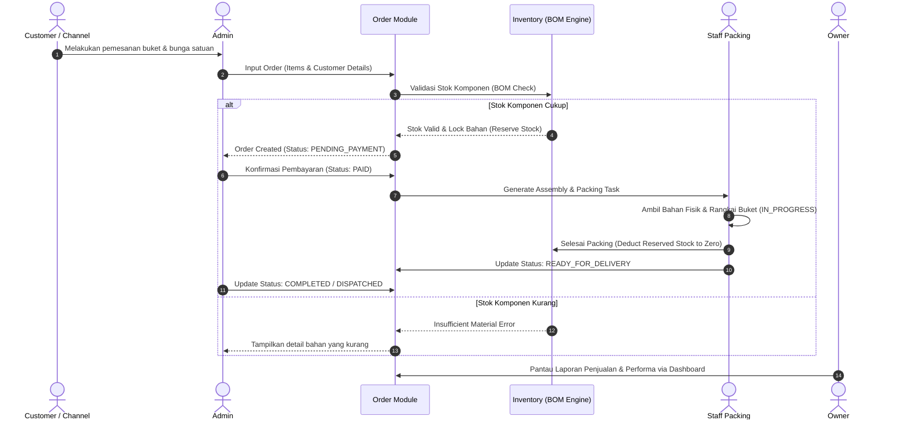
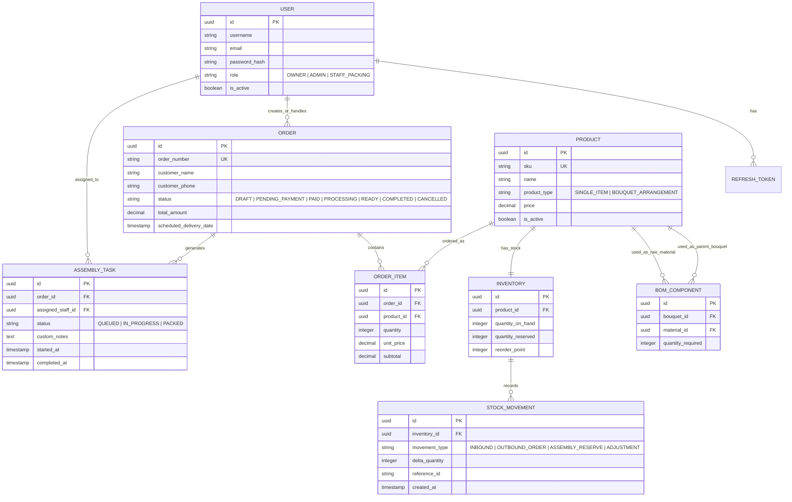
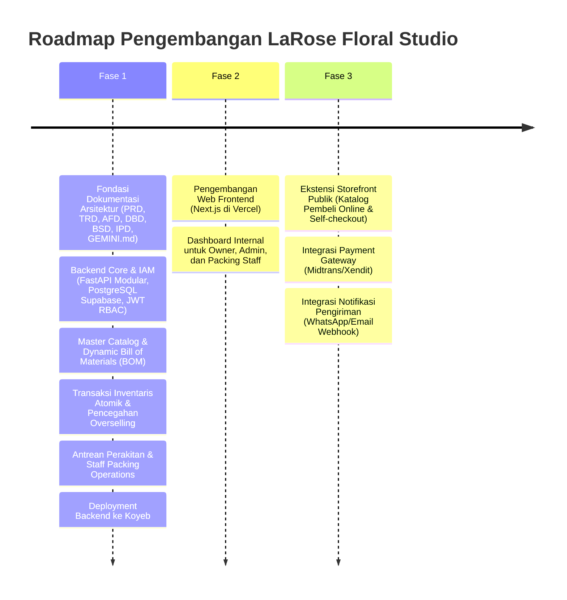

# Product Requirements Document (PRD)
## LaRose Floral Studio — Intelligent Artificial Florist & Inventory Management System

---

### 1. Ringkasan Eksekutif (Executive Summary)

**LaRose Floral Studio** adalah sistem terpadu pengelolaan operasional toko bunga artifisial (bunga palsu) berbasis arsitektur modular terpisah (*frontend-backend segregation*). Sistem ini dirancang untuk menyelesaikan tantangan unik bisnis bunga artifisial, di mana penjualan dilakukan dalam dua bentuk utama: **produk satuan** (misal: tangkai bunga tiruan, daun hias, pita, kertas wrapping) dan **rangkaian buket/komposisi** (misal: buket wisuda, buket meja, hampers) yang mengonsumsi komponen satuan melalui mekanisme **Bill of Materials (BOM)**.

Proyek ini dibangun sebagai proyek portofolio bertaraf profesional yang menonjolkan kompetensi ganda:
1. **Backend Software Engineer**: Arsitektur modular Python, transaksi database terisolasi (*atomic transactions*), pengelolaan konkurensi stok komponen, REST API bersih, dan pemisahan *concern* domain.
2. **System Analyst & Solution Architect**: Perancangan sistem berbasis analisis mendalam, pemodelan relasional yang fleksibel dan terukur (*scalable*), serta pendokumentasian rekayasa sistem berstandar industri.

---

### 2. Visi Produk & Problem Statement

#### 2.1 Problem Statement
1. **Kompleksitas Hubungan Stok Satuan vs Rangkaian**: Berbeda dengan produk ritel umum, sebuah buket bunga tiruan tersusun dari beberapa tangkai bunga satuan, aksesoris, dan bahan pembungkus. Tanpa sistem *Bill of Materials (BOM)* otomatis, toko berisiko mengalami *overselling* tangkai satuan yang sebetulnya telah dialokasikan untuk pesanan buket, atau sebaliknya.
2. **Ketiadaan Pelacakan Alur Kerja Internal**: Toko floris manual sering mengalami hambatan komunikasi antara bagian penerima pesanan (Admin) dan bagian perakitan fisik (Staff Packing/Assembly), menyebabkan pesanan terlewat atau waktu pemrosesan tidak terukur.
3. **Visibilitas Performa Bisnis Rendah**: Owner kesulitan memantau margin keuntungan per buket, sisa bahan baku berlebih (*slow-moving stems*), dan produktivitas harian tim perakitan.

#### 2.2 Solusi & Value Proposition
* **Dynamic Bill of Materials (BOM)**: Sistem secara otomatis memotong stok bahan satuan (tangkai bunga, kertas wrapping, pita) saat buket dipesan atau dirakit, sekaligus mendukung buket *pre-made* (stok siap kirim).
* **Role-Based Operational Flow**: Pemisahan hak akses dan alur kerja yang jelas antara **Owner**, **Admin**, dan **Staff Packing**.
* **Decoupled Architecture Ready**: Backend Python modular independen (di-host di Koyeb) siap melayani backoffice internal saat ini, dan dirancang terbuka untuk penambahan *storefront* publik (Next.js di Vercel) pada fase berikutnya tanpa perombakan arsitektur dasar.

---

### 3. Persona & Aktor Pengguna

Sistem mengadopsi pendekatan berfase. Pada **Fase 1 (MVP Portofolio)**, sistem berfokus pada 3 aktor internal toko. Pada **Fase 2 (Scale-up)**, sistem akan diperluas untuk mendukung pembeli publik.

| Aktor | Peran & Hak Akses | Kebutuhan Utama |
| :--- | :--- | :--- |
| **Owner** | Pemilik bisnis dengan hak akses penuh (*Superadmin*). | - Dashboard analitik penjualan dan margin keuntungan. - Laporan stok kritis dan perputaran barang. - Manajemen akun dan penugasan peran staf. - Audit log aktivitas operasional. |
| **Admin** | Operator toko yang mengelola katalog, stok, dan pesanan masuk. | - Manajemen master data bunga satuan & bahan wrapping. - Perumusan resep buket (BOM / *component recipes*). - Input pesanan masuk dari multi-channel (WhatsApp, offline, marketplace). - Validasi pembayaran dan penugasan pesanan ke antrean packing. |
| **Staff Packing** | Petugas gudang dan perakit buket fisik (*Floral Assembler*). | - Antrean kerja real-time (*Assembly Queue*). - Lembar kerja perakitan (daftar komponen & bahan buket yang harus diambil). - Konfirmasi status perakitan (Mulai Rakit $\rightarrow$ Selesai $\rightarrow$ Siap Kirim). - Pelaporan bahan rusak/cacat fisik. |
| **Pembeli (Fase 2)** | Pelanggan eksternal toko bunga. | - Akses katalog publik bunga satuan dan buket. - Pemesanan mandiri (*self-checkout*). - Pelacakan status pesanan real-time via kode unik/nomor resi. |

---

### 4. Kebutuhan Fungsional (Functional Requirements)

#### 4.1 Modul 1: Identity & Access Management (IAM)
* **FR-IAM-01**: Sistem harus menyediakan mekanisme autentikasi aman berbasis JWT (JSON Web Token).
* **FR-IAM-02**: Sistem harus membatasi endpoint API berdasarkan Role-Based Access Control (RBAC): `OWNER`, `ADMIN`, `STAFF_PACKING`.
* **FR-IAM-03**: Owner dapat mengelola akun pengguna (membuat, mengubah peran, menonaktifkan pengguna internal).

#### 4.2 Modul 2: Catalog & Bill of Materials (BOM) Management
* **FR-CAT-01**: Sistem mendukung dua tipe produk utama:
  * `SINGLE_ITEM`: Bunga satuan (misal: Rose Tangkai Velvet Merah, Lily Artificial Putih), daun hias, bahan pembungkus (cellophane paper), dan aksesoris (pita satin, kartu ucapan).
  * `BOUQUET_ARRANGEMENT`: Rangkaian buket atau hampers yang memiliki formula komposisi (BOM).
* **FR-CAT-02**: Admin dapat menentukan resep BOM untuk setiap produk buket, mencakup daftar `SINGLE_ITEM` dan kuantitas yang dibutuhkan per 1 unit buket.
* **FR-CAT-03**: Sistem mendukung buket *pre-made* (buket yang sudah dirakit terlebih dahulu dan memiliki stok fisik langsung) maupun buket *made-to-order* (dirakit saat ada pesanan masuk, memotong stok bahan baku).

#### 4.3 Modul 3: Inventory & Material Ledger
* **FR-INV-01**: Sistem harus mencatat kuantitas fisik (`quantity_on_hand`) dan kuantitas teralokasi (`quantity_reserved`) untuk setiap item bahan satuan.
* **FR-INV-02**: Stok tersedia (*available stock*) dihitung secara konsisten: $\text{Available} = \text{On Hand} - \text{Reserved}$.
* **FR-INV-03**: Setiap mutasi stok (penambahan stok masuk/restock, pengurangan akibat penjualan, penyesuaian opname/rusak) harus dicatat secara *append-only* di tabel riwayat pergerakan stok (*Stock Ledger / Inventory Movement*) untuk audit trail.
* **FR-INV-04**: Sistem harus menyediakan peringatan stok minimum (*low stock alert*) untuk bahan satuan kritis.

#### 4.4 Modul 4: Order Intake & Processing
* **FR-ORD-01**: Admin dapat membuat pesanan baru (*Manual Order Intake*) yang mencantumkan nama pelanggan, detail kontak, alamat pengiriman, tanggal permintaan kirim, dan rincian item pesanan.
* **FR-ORD-02**: Ketika pesanan buket dibuat, sistem secara otomatis mengecek ketersediaan bahan komponen berdasarkan resep BOM.
* **FR-ORD-03**: Sistem menerapkan transaksi *atomic*: jika stok bahan mencukupi, bahan langsung dipindahkan ke status `reserved` untuk mencegah *overselling*.
* **FR-ORD-04**: Admin dapat mencatat status pembayaran (`UNPAID`, `PAID`, `CANCELLED`).

#### 4.5 Modul 5: Assembly & Packing Operations
* **FR-PCK-01**: Pesanan berstatus `PAID` secara otomatis memunculkan tugas perakitan (*Assembly Task*) pada antrean kerja Staff Packing.
* **FR-PCK-02**: Staff Packing dapat melihat instruksi perakitan (BOM spesifik per buket dan instruksi kustomisasi seperti warna wrapping/pita).
* **FR-PCK-03**: Alur status perakitan: `QUEUED` $\rightarrow$ `IN_PROGRESS` $\rightarrow$ `PACKED` $\rightarrow$ `READY_FOR_DELIVERY`.
* **FR-PCK-04**: Saat status berubah menjadi `PACKED`, stok bahan baku yang sebelumnya berstatus `reserved` resmi dipotong dari `quantity_on_hand` fisik.

#### 4.6 Modul 6: Business Intelligence & Reporting (Owner Dashboard)
* **FR-REP-01**: Menampilkan ringkasan pendapatan harian/bulanan, jumlah pesanan selesai, dan tingkat pembatalan.
* **FR-REP-02**: Menampilkan daftar produk terlaris (*best-selling bouquets & single stems*).
* **FR-REP-03**: Menampilkan estimasi nilai valuasi inventaris bahan baku saat ini.

---

### 5. Kebutuhan Non-Fungsional (Non-Functional Requirements)

1. **Integritas & Keandalan Transaksi (Data Integrity)**:
   * Alokasi stok dan perakitan BOM wajib dijalankan di dalam blok transaksi terisolasi (*PostgreSQL ACID Transactions*) dengan penguncian baris (*pessimistic row locking*) untuk mencegah kondisi balapan (*race condition*).
2. **Modular Monolith Architecture**:
   * Struktur kode backend Python harus terbagi dalam domain modul yang kohesif (`iam`, `catalog`, `inventory`, `orders`, `assembly`, `reports`) dengan dependensi antarmuka yang bersih (*Clean/Hexagonal Architecture principles*).
3. **API Performance & Latency**:
   * P95 response time untuk endpoint katalog dan mutasi inventaris $< 200\text{ ms}$.
4. **Security & Data Protection**:
   * Hashing kata sandi menggunakan Argon2id atau bcrypt.
   * Komunikasi HTTPS terenkripsi penuh melalui Koyeb SSL termination.
   * Supabase PostgreSQL diakses via connection string aman berparameter SSL.
5. **Portability & Cloud Compatibility**:
   * Konfigurasi berbasis environment variables (*12-Factor App*).
   * Siap dijalankan melalui container Docker pada platform PaaS (Koyeb).

---

### 6. Alur Bisnis Makro (Macro Business Flow)

---

### 7. Entity Relationship Diagram Konseptual (Conceptual ERD)

---

### 8. Rencana Fase Pengembangan (Roadmap)

