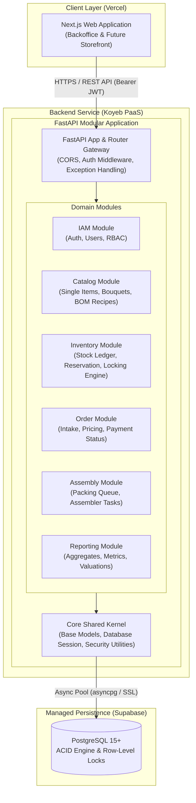
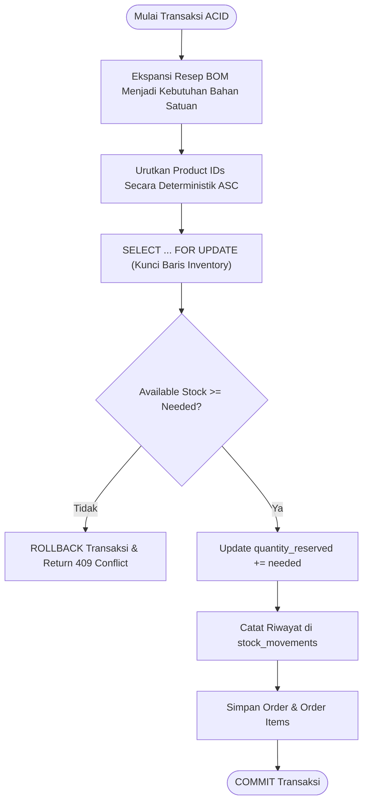
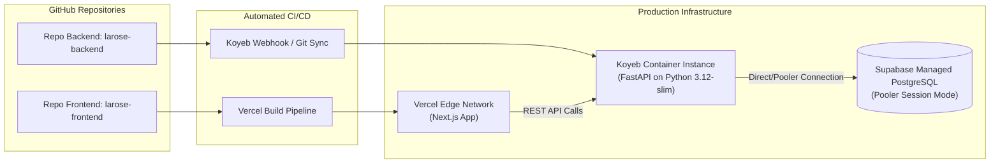

# Technical Requirements Document (TRD)
## LaRose Floral Studio — Modular Backend System Architecture

---

### 1. Arsitektur Sistem Makro (C4 Container Diagram)

Sistem LaRose mengadopsi prinsip **Frontend-Backend Segregation** dengan arsitektur **Modular Monolith** pada sisi backend. Komponen frontend dan backend terpisah secara fisik dan logis, berkomunikasi melalui antarmuka REST API berbasis JSON terenkripsi SSL.



---

### 2. Tech Stack & Version Matrix

| Komponen | Teknologi | Versi Target | Alasan Pemilihan & Peran |
| :--- | :--- | :--- | :--- |
| **Language Runtime** | Python | `3.12+` | Dukungan typing modern (*PEP 695 type parameter syntax*), efisiensi async event loop. |
| **Web Framework** | FastAPI | `^0.115.0` | Asinkron murni, validasi payload deklaratif via Pydantic v2, dokumentasi interaktif OpenAPI/Swagger. |
| **Data Validation** | Pydantic | `^2.9.0` | Validasi skema request/response berperforma tinggi (Rust-based core), parsing tipe ketat. |
| **ORM & Query Builder** | SQLAlchemy (AsyncIO) | `^2.0.35` | Standard emas ORM Python, kontrol penuh atas query SQL kompleks, transaksi ACID, dan `SELECT ... FOR UPDATE`. |
| **Database Driver** | asyncpg | `^0.29.0` | Driver PostgreSQL asinkron tercepat untuk ekosistem Python asyncio. |
| **Database Migration** | Alembic | `^1.13.0` | Manajemen versi skema database otomatis berbasis revisi terkelola. |
| **Security & Hashing** | passlib / bcrypt / PyJWT | `latest` | Hashing kata sandi berbasis bcrypt/argon2 dan pengelolaan token JWT stateless. |
| **Database Server** | PostgreSQL (Supabase) | `15+` | RDBMS relasional tangguh dengan integritas referensial penuh dan fitur transactional row-level lock. |
| **Containerization** | Docker | Multi-stage | Build minimalis berbasis `python:3.12-slim` untuk efisiensi image dan keamanan production. |
| **Backend Host** | Koyeb | Cloud PaaS | Deployment berbasis git/docker dengan auto-SSL, health-check built-in, dan latensi rendah. |
| **Frontend Host** | Vercel | Cloud Edge | Platform deployment optimal untuk Next.js dengan automated CI/CD. |
| **Automated Testing** | Pytest + pytest-asyncio | `^8.3.0` | Pengujian asinkron komprehensif dengan test database PostgreSQL terisolasi. |

---

### 3. Arsitektur Modular Backend (Clean Architecture)

Backend diorganisir menggunakan pendekatan **Modular Monolith** dengan pemisahan lapisan internal (*Separation of Concerns*) pada setiap modul domain:

```
src/
├── core/                        # Shared Kernel
│   ├── config.py                # Environment configuration (Pydantic BaseSettings)
│   ├── database.py              # Async engine & sessionmaker (SQLAlchemy)
│   ├── security.py              # Password hashing & JWT helpers
│   ├── exceptions.py            # Global custom HTTP exception classes
│   └── pagination.py            # Shared pagination schemas & helpers
├── modules/
│   ├── iam/                     # Identity & Access Management
│   │   ├── domain/              # Entities, enums, business rules
│   │   ├── schemas/             # Pydantic DTOs (Request/Response)
│   │   ├── models/              # SQLAlchemy ORM models
│   │   ├── repositories/        # Database access layer
│   │   ├── services/            # Business logic
│   │   └── router.py            # FastAPI endpoints
│   ├── catalog/                 # Single items, bouquets, BOM recipes
│   ├── inventory/               # Physical stock, ledger, reservation engine
│   ├── orders/                  # Order lifecycle & intake
│   ├── assembly/                # Packing queue & assembly workflow
│   └── reports/                 # Analytical aggregation & metrics
└── main.py                      # Application factory & router mounting
```

#### Aturan Komunikasi Antar-Modul:
1. Setiap modul independen dalam definisi entitas dan router-nya.
2. Modul hanya boleh berinteraksi dengan modul lain melalui antarmuka **Service** (bukan mengakses tabel modul lain secara langsung via raw queries).
3. Transaksi atomik lintas modul dikoordinasikan oleh unit transaksi `AsyncSession` bersama.

---

### 4. Skema Basis Data Inti (Core DDL Specification)

Seluruh tabel menggunakan tipe data `UUID` (v4/v7) sebagai Primary Key untuk mencegah *enumeration attack* dan memudahkan partisi masa depan.

```sql
-- Enums
CREATE TYPE user_role AS ENUM ('OWNER', 'ADMIN', 'STAFF_PACKING');
CREATE TYPE product_type AS ENUM ('SINGLE_ITEM', 'BOUQUET_ARRANGEMENT');
CREATE TYPE order_status AS ENUM ('DRAFT', 'PENDING_PAYMENT', 'PAID', 'PROCESSING', 'READY_FOR_DELIVERY', 'COMPLETED', 'CANCELLED');
CREATE TYPE task_status AS ENUM ('QUEUED', 'IN_PROGRESS', 'PACKED');
CREATE TYPE movement_type AS ENUM ('INBOUND_RESTOCK', 'ORDER_RESERVED', 'ORDER_RELEASED', 'ASSEMBLY_DEDUCTED', 'SCRAP_DAMAGED', 'ADJUSTMENT');

-- 1. IAM: Users
CREATE TABLE users (
    id UUID PRIMARY KEY DEFAULT gen_random_uuid(),
    username VARCHAR(50) UNIQUE NOT NULL,
    email VARCHAR(255) UNIQUE NOT NULL,
    password_hash VARCHAR(255) NOT NULL,
    full_name VARCHAR(100) NOT NULL,
    role user_role NOT NULL DEFAULT 'STAFF_PACKING',
    is_active BOOLEAN NOT NULL DEFAULT TRUE,
    created_at TIMESTAMP WITH TIME ZONE NOT NULL DEFAULT CURRENT_TIMESTAMP,
    updated_at TIMESTAMP WITH TIME ZONE NOT NULL DEFAULT CURRENT_TIMESTAMP
);

-- 2. Catalog: Products (Single Item & Bouquet)
CREATE TABLE products (
    id UUID PRIMARY KEY DEFAULT gen_random_uuid(),
    sku VARCHAR(50) UNIQUE NOT NULL,
    name VARCHAR(150) NOT NULL,
    description TEXT,
    product_type product_type NOT NULL,
    price NUMERIC(12, 2) NOT NULL CHECK (price >= 0),
    is_premade BOOLEAN NOT NULL DEFAULT FALSE,
    is_active BOOLEAN NOT NULL DEFAULT TRUE,
    created_at TIMESTAMP WITH TIME ZONE NOT NULL DEFAULT CURRENT_TIMESTAMP,
    updated_at TIMESTAMP WITH TIME ZONE NOT NULL DEFAULT CURRENT_TIMESTAMP
);

-- 3. Catalog: Bill of Materials (BOM Recipes)
CREATE TABLE bom_components (
    id UUID PRIMARY KEY DEFAULT gen_random_uuid(),
    bouquet_id UUID NOT NULL REFERENCES products(id) ON DELETE CASCADE,
    material_id UUID NOT NULL REFERENCES products(id) ON DELETE RESTRICT,
    quantity_required INT NOT NULL CHECK (quantity_required > 0),
    created_at TIMESTAMP WITH TIME ZONE NOT NULL DEFAULT CURRENT_TIMESTAMP,
    CONSTRAINT uq_bouquet_material UNIQUE (bouquet_id, material_id)
);

-- 4. Inventory: Balances & Reservations
CREATE TABLE inventory (
    id UUID PRIMARY KEY DEFAULT gen_random_uuid(),
    product_id UUID UNIQUE NOT NULL REFERENCES products(id) ON DELETE CASCADE,
    quantity_on_hand INT NOT NULL DEFAULT 0 CHECK (quantity_on_hand >= 0),
    quantity_reserved INT NOT NULL DEFAULT 0 CHECK (quantity_reserved >= 0),
    reorder_point INT NOT NULL DEFAULT 10 CHECK (reorder_point >= 0),
    updated_at TIMESTAMP WITH TIME ZONE NOT NULL DEFAULT CURRENT_TIMESTAMP,
    CONSTRAINT chk_reserved_lte_on_hand CHECK (quantity_reserved <= quantity_on_hand)
);

-- 5. Inventory: Immutable Stock Movement Ledger
CREATE TABLE stock_movements (
    id UUID PRIMARY KEY DEFAULT gen_random_uuid(),
    inventory_id UUID NOT NULL REFERENCES inventory(id) ON DELETE CASCADE,
    movement_type movement_type NOT NULL,
    delta_quantity INT NOT NULL, -- Positif untuk penambahan, negatif untuk pengurangan
    reference_id VARCHAR(100),   -- misal: Order Number atau Assembly Task ID
    notes TEXT,
    created_by_user_id UUID REFERENCES users(id) ON DELETE SET NULL,
    created_at TIMESTAMP WITH TIME ZONE NOT NULL DEFAULT CURRENT_TIMESTAMP
);

-- 6. Orders: Headers
CREATE TABLE orders (
    id UUID PRIMARY KEY DEFAULT gen_random_uuid(),
    order_number VARCHAR(50) UNIQUE NOT NULL,
    customer_name VARCHAR(100) NOT NULL,
    customer_phone VARCHAR(30) NOT NULL,
    customer_address TEXT,
    delivery_date DATE,
    status order_status NOT NULL DEFAULT 'PENDING_PAYMENT',
    total_amount NUMERIC(12, 2) NOT NULL DEFAULT 0.00 CHECK (total_amount >= 0),
    notes TEXT,
    created_by_user_id UUID REFERENCES users(id) ON DELETE SET NULL,
    created_at TIMESTAMP WITH TIME ZONE NOT NULL DEFAULT CURRENT_TIMESTAMP,
    updated_at TIMESTAMP WITH TIME ZONE NOT NULL DEFAULT CURRENT_TIMESTAMP
);

-- 7. Orders: Line Items
CREATE TABLE order_items (
    id UUID PRIMARY KEY DEFAULT gen_random_uuid(),
    order_id UUID NOT NULL REFERENCES orders(id) ON DELETE CASCADE,
    product_id UUID NOT NULL REFERENCES products(id) ON DELETE RESTRICT,
    quantity INT NOT NULL CHECK (quantity > 0),
    unit_price NUMERIC(12, 2) NOT NULL CHECK (unit_price >= 0),
    subtotal NUMERIC(12, 2) NOT NULL CHECK (subtotal >= 0)
);

-- 8. Assembly: Operations & Queue
CREATE TABLE assembly_tasks (
    id UUID PRIMARY KEY DEFAULT gen_random_uuid(),
    order_id UUID NOT NULL REFERENCES orders(id) ON DELETE CASCADE,
    assigned_staff_id UUID REFERENCES users(id) ON DELETE SET NULL,
    status task_status NOT NULL DEFAULT 'QUEUED',
    custom_instructions TEXT,
    started_at TIMESTAMP WITH TIME ZONE,
    completed_at TIMESTAMP WITH TIME ZONE,
    created_at TIMESTAMP WITH TIME ZONE NOT NULL DEFAULT CURRENT_TIMESTAMP,
    updated_at TIMESTAMP WITH TIME ZONE NOT NULL DEFAULT CURRENT_TIMESTAMP
);

-- Indexing Strategis
CREATE INDEX idx_products_sku ON products(sku);
CREATE INDEX idx_products_type ON products(product_type);
CREATE INDEX idx_bom_bouquet ON bom_components(bouquet_id);
CREATE INDEX idx_orders_status ON orders(status);
CREATE INDEX idx_orders_delivery_date ON orders(delivery_date);
CREATE INDEX idx_assembly_status ON assembly_tasks(status);
CREATE INDEX idx_stock_movements_inv_created ON stock_movements(inventory_id, created_at DESC);
```

#### Kebijakan Perubahan Skema & Perlindungan Data Mutlak (Schema Governance & Data Preservation)
* **Persetujuan Wajib untuk Perubahan Struktur**: Dilarang keras mengubah struktur tabel (menambah/menghapus/mengubah kolom, relasi, tipe data, atau index) tanpa persetujuan tertulis eksplisit dari USER.
* **Larangan Penghapusan Data Tabel**: Dilarang keras menghapus atau mengosongkan data tabel (`DROP`, `TRUNCATE`, bulk `DELETE`) tanpa persetujuan eksplisit dari USER.
* **Prinsip Non-Destructive Migrations**: Seluruh migrasi database wajib bersifat non-destruktif dan **TIDAK BOLEH menghapus data yang sudah ada**. Jika dalam kondisi luar biasa terdapat kebutuhan perubahan struktural yang berisiko memodifikasi atau menghilangkan data eksisting, analisis risiko dan rencana cadangan (*backup plan*) wajib dipaparkan dan disetujui secara tegas oleh USER sebelum dieksekusi.

---

### 5. Protokol Concurrency Control & Transaksi Stok Atomik

Salah satu tantangan kritis adalah mencegah *overselling* saat beberapa pesanan buket atau bunga satuan dibuat bersamaan.

#### Mekanisme Pessimistic Locking (`SELECT ... FOR UPDATE`):
1. **Urutan Penguncian Terurut (Deterministic Ordering)**:
   * Seluruh ID item bahan satuan yang terlibat dalam pesanan (baik item langsung maupun hasil ekspansi resep BOM buket) diurutkan secara leksikografis/alfabetis (`ORDER BY id ASC`).
   * Pengurutan ID ini wajib untuk **mencegah terjadinya deadlock** antar transaksi yang berjalan paralel.
2. **Kueri Penguncian Eksklusif**:
   ```sql
   SELECT id, quantity_on_hand, quantity_reserved 
   FROM inventory 
   WHERE product_id IN (:sorted_product_ids) 
   ORDER BY product_id ASC 
   FOR UPDATE;
   ```
3. **Validasi Ketersediaan Stok**:
   * Sistem memeriksa apakah $\text{quantity\_on\_hand} - \text{quantity\_reserved} \ge \text{quantity\_needed}$ untuk setiap bahan.
   * **Jika Cukup**:
     * Perbarui `quantity_reserved = quantity_reserved + quantity_needed`.
     * Rekam mutasi ke tabel `stock_movements` dengan tipe `ORDER_RESERVED`.
     * Lanjutkan pembuatan pesanan dan komit transaksi (`COMMIT`).
   * **Jika Kurang**:
     * Batalkan seluruh operasi (`ROLLBACK`).
     * Kembalikan HTTP 409 Conflict / 422 Unprocessable Entity disertai rincian bahan yang kekurangan stok.



---

### 6. Autentikasi, Otorisasi & Keamanan

1. **Authentication Flow**:
   * Endpoint: `POST /api/v1/auth/token` (OAuth2 Password Request Form).
   * Validasi kredensial pengguna terhadap `password_hash` menggunakan `passlib` (bcrypt/argon2).
   * Menghasilkan **Access Token** (JWT, kedaluwarsa 60 menit) dan **Refresh Token** (kedaluwarsa 7 hari).
2. **Role-Based Access Control (RBAC)**:
   * Diterapkan menggunakan FastAPI `Depends()` pada tingkat router/endpoint.
   * Matriks Izin:
     * `OWNER`: Akses semua endpoint termasuk laporan omzet, audit trail, dan manajemen staf.
     * `ADMIN`: Akses katalog, manajemen stok, order intake, pembaruan pembayaran.
     * `STAFF_PACKING`: Akses terbatas ke antrean `assembly_tasks` dan status pengerjaan packing.
3. **CORS Policy**:
   * Konfigurasi ketat `CORSMiddleware` dengan daftar domain terpercaya: domain frontend Vercel (`https://larose-*.vercel.app`) dan `localhost:3000` (development).

---

### 7. Standar Desain REST API & Format Respon

Seluruh respon API dikemas dalam format envelope standar untuk konsistensi integrasi frontend:

#### Sukses (`200 OK`, `201 Created`):
```json
{
  "success": true,
  "data": {
    "id": "c1f72b64-8173-455b-b9d9-95a97576f3f0",
    "orderNumber": "ORD-202611-0001",
    "status": "PENDING_PAYMENT",
    "totalAmount": 275000.00
  },
  "message": "Order successfully created and stock reserved."
}
```

#### Kesalahan (`400 Bad Request`, `401 Unauthorized`, `409 Conflict`, `422 Validation Error`):
```json
{
  "success": false,
  "error": {
    "code": "INSUFFICIENT_STOCK",
    "message": "Bahan baku tidak mencukupi untuk merangkai buket.",
    "details": [
      {
        "productId": "9b1deb4d-3b7d-4bad-9bdd-2b0d7b3dcb6d",
        "productName": "Red Velvet Rose Stem",
        "requested": 12,
        "available": 5
      }
    ]
  }
}
```

---

### 8. Strategi Deployment & Hosting



1. **Docker Containerization**:
   * Base image: `python:3.12-slim`.
   * Non-root user execution (`appuser`) untuk mitigasi celah keamanan container.
   * Entrypoint: `uvicorn src.main:app --host 0.0.0.0 --port 8000 --workers 2`.
2. **Koyeb Configuration**:
   * Health-check HTTP endpoint: `/healthz`.
   * Environment variable management: `DATABASE_URL`, `JWT_SECRET_KEY`, `CORS_ORIGINS`.
3. **Supabase Connection Pooling**:
   * Menggunakan connection string direct atau session pooler Supabase (Port 5432/6543) dengan parameter `sslmode=require`.

---

### 9. Strategi Pengujian (Automated Testing Strategy)

1. **Test Runner**: Pytest dengan plugin `pytest-asyncio`.
2. **Isolasi Database Uji**:
   * Pengujian menggunakan database PostgreSQL terpisah (dedicated test database).
   * Setiap fungsi uji (*test case*) membungkus operasi di dalam transaksi database yang di-rollback secara otomatis di akhir pengujian (`transaction rollback per test`), menjaga data tetap bersih.
3. **Cakupan Pengujian Kritis**:
   * **Unit Tests**: Perhitungan BOM, validasi Pydantic schemas, password hashing.
   * **Integration Tests (Concurrency)**: Simulasi 10 request bersamaan (*concurrent checkout*) untuk memvalidasi bahwa `SELECT ... FOR UPDATE` berhasil mencegah *double-spending / overselling*.
   * **End-to-End API Tests**: Alur autentikasi login $\rightarrow$ buat pesanan $\rightarrow$ konfirmasi bayar $\rightarrow$ antrean packing $\rightarrow$ update status selesai.
